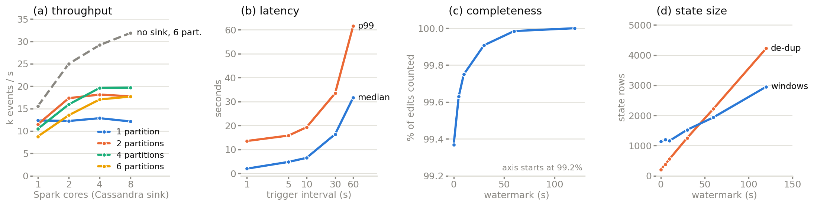

## 1. Problem and what was built

A sudden concentration of edits on one Wikipedia page usually means breaking news, vandalism or an edit war, or a bot run. This project builds a streaming pipeline that finds such per-page surges while they happen, labels them bot-dominated or human-dominated, and measures the pipeline itself: how event-time windows and watermarks behave when revision timestamps lag arrival, how much state a long-tailed key space costs, what throughput and latency it sustains, and whether checkpointed state recovers correctly. The detector is kept simple because the pipeline is what the project studies.

## 2. Tools

Everything runs locally under Docker Compose with pinned versions and needs no account or credential. The producer reads the Wikimedia `recentchange` event stream and writes each edit to Kafka 3.9 (KRaft, 6 partitions, key `wiki|title`) and to a date- and hour-partitioned Parquet archive in MinIO. Spark 3.5.7 Structured Streaming (RocksDB state store) aggregates the topic; Spark SQL computes reference distributions over the archive; results are upserted into Cassandra 5.0.4, which a Streamlit dashboard reads. MinIO no longer publishes images or binaries, so it is built from a pinned source commit.

```
Wikimedia SSE -> producer -+-> Kafka wiki-edits (key wiki|title) -> Spark Structured Streaming -> Cassandra -> Streamlit
                           +-> MinIO archive (Parquet, date/hour) -> Spark SQL reference job (thresholds) and replay tool
```

## 3. Data

The feed is public and needs no authentication, and the producer keeps edits and new pages (`type in ('edit','new')`) with eleven fields (the proposal's ten plus `id`, for de-duplication, and `arrival`, to measure lag). Measured on 25.2 hours and 1.32 million real edits:

| | Proposal | Measured |
|---|---|---|
| Edits per second | 16.5 | 14.5 |
| Share of the three busiest wikis | 71% | 68% |
| Revision-to-arrival lag | median 1.7 s, max 67 s | median 1.3 s, p99 11 s, max 177 s |
| Page-minutes with a single edit | 93% | 94.4% |
| Archive size, compressed | 0.15 GB/day (estimate) | 0.056 GB/day (44.6 bytes per edit) |

The archive holds **12.76 million synthetic edits for the ten days from 2026-09-24 10:30 to 2026-10-04 10:30 UTC, followed by the real edits from 10:32 on 2026-10-04**. The synthetic part exists so that ten days of data are available without waiting ten days, and it is a run-level bootstrap fitted to the real data: each real (page, minute) window is a template (its edits, offsets, lags, bot flags, number of editors), and synthetic minutes draw templates at the real hour-of-day rate per wiki, with fresh pages, editors, times and ids. Synthetic files are named `synthetic-*`, titles and editors carry a `SYN_` prefix, and ids start at 10^12. Twenty-two synthetic hours were compared with the real 22 hours on 16 statistics (rate, wiki mix, bot share, burst sizes, contested windows, page novelty, lag percentiles, length changes); all fall within their tolerances, and two modelling bugs were found and fixed this way. All measurements in section 5 were taken on the synthetic part of the archive.

## 4. Methodology

1. Ingest. The producer reconnects with exponential backoff and resumes from the SSE `Last-Event-ID`, so sleeps and disconnections left no hole in the archive. It is at-least-once; every downstream job de-duplicates on (`wiki`, `id`), because `id` is a per-wiki counter.
2. Reference distributions. Spark SQL counts edits per page per minute and computes, per namespace, the 99.9th percentile, plus hourly rate and bot share per wiki; a mean-plus-k-sigma rule is not used because the counts are zero-inflated and heavy-tailed. The quantile is taken over *contested* windows only (at least two distinct editors): the largest windows overall are one bot editing one item (up to 90 edits in a minute), and a threshold set by them would sit above every genuine multi-editor surge. On the 14.2 million-row archive the threshold is 19 edits per page-minute (26,151 contested windows). Collection continued to 2026-10-22; rerun on that final 35.8 million-row archive (63,844 contested windows) the threshold is still 19.
3. Streaming aggregation. Event time is the revision timestamp. The job groups by (wiki, page, one-minute tumbling window) and computes edit count, distinct editors, bot fraction and net bytes, with a 60-second watermark, `dropDuplicatesWithinWatermark(id)`, update output mode and a 10-second trigger.
4. Surge scoring. A window is flagged when its count is strictly above its namespace threshold and it has at least two distinct editors; it is bot-dominated when at least half its edits are bot edits.
5. Serving. A `foreachBatch` sink upserts windows (`PRIMARY KEY ((wiki, day), window_start, page)`) and alerts (`PRIMARY KEY ((day), window_start, wiki, page)`), so rewriting a window is idempotent and a day bounds partition growth, and the dashboard reads one partition per query.
6. Evaluation. A harness replays the archive into scratch topics at a chosen rate or speed and runs the real query with chosen settings, recording Spark's progress metrics for each run. A run that overlaps a laptop sleep is detected (wall clock minus uptime clock) and repeated; one closed lid had made a 30-second run take 34 minutes.

## 5. Results

{width=100%}

<p class="cap">Figure: (a) throughput with the Cassandra sink, plus a no-sink line; (b) median and p99 latency; (c) completeness and (d) state size, against watermark length.</p>

All runs used 6 hours of the archive (338,430 edits) on one 8-CPU machine with Spark in local mode, with one repetition unless noted.

- Throughput grows with cores until cores equal Kafka partitions, then flattens. One partition stays near 12,000 edits/s on any core count, and the best Cassandra-sink run reaches 19,700 edits/s (4 partitions, 4 to 8 cores). With a no-op sink, 6 partitions reach 31,900 edits/s on 8 cores, so the Cassandra sink costs about 45% at that point.
- Key `wiki|title` keeps the six partitions within 2% of each other. Key `wiki` alone gives a 10-fold spread (124,698 to 12,472 messages in one run) and a slowest task 1.19 to 1.26 times the median, but over three repetitions no reliable throughput loss: the means are 29,800 and 30,200 edits/s and the run-to-run spread (16% and 22%) is larger than the difference.
- Latency from revision timestamp to Cassandra has a median of 1.95 s at a 1-second trigger and 31.6 s at 60 seconds: about half the trigger interval plus the feed's 1.3 s median lag. The p99 (13.5 s to 61.6 s) follows the feed's own tail.
- With the watermark, completeness rises from 99.37% with no watermark to 99.98% at 60 s and 100.00% at 120 s. State grows too: de-duplication state from 204 to 4,224 rows (21 times) and window state from 1,137 to 2,952 (2.6 times), so de-duplication is what scales. Spark's own late-row counter reads zero while edits are being lost, so completeness is measured from Cassandra's summed counts instead.
- For fault recovery, the process was killed with SIGKILL after 2, 5 and 8 committed batches, each time with the next batch already planned. After a restart from the same checkpoint, the tables hold the same 310,572 windows as an uninterrupted run, none lost or invented, with identical alerts. Four to eight windows differ in value, because which of two edits near a batch boundary counts as the last depends on timing. Two uninterrupted reruns differ from the reference by four and five, so recovery is as exact as the pipeline's own run-to-run noise.

## 6. Limitations

Measurements come from one laptop with local-mode Spark, mostly one repetition, on synthetic data fitted to 22 real hours (a Sunday to a Monday, so no weekday pattern). Latency is stamped just before the Cassandra write, so it omits the 1 to 2 s write itself. The detector was not evaluated for precision or recall (there is no ground truth), and the strict rule flags few windows: 4 on live data, all bot-dominated. The live query wrote the real `windows` and `alerts` tables until 2026-10-05 and has not run since, so those tables and the dashboard end there, while all experiments ran on archive replay.

## 7. Running the code

Requirements: Docker with Compose v2 (about 6 GB of RAM for Docker, 15 GB of disk) and, for the evaluation, Python 3 on the host, with no account or credential needed. The archive is a Docker volume, not part of the repository, so the steps below first collect real data (needs internet) and then build the synthetic backfill from it.

```
docker compose up -d --build                      # Kafka, MinIO, Cassandra, Spark, producer; first build about 20 minutes
docker compose logs producer | grep flushed       # a "flushed" line every 5 minutes: the real archive is filling
                                                  # let it collect for a day or more (an hour is the minimum)
docker compose --profile tools run --rm synth validate       # optional check, last line: VALIDATE OK
docker compose --profile tools run --rm synth generate --days 10     # 10 synthetic days before the real data
docker compose exec spark /opt/spark/bin/spark-submit /jobs/reference.py   # thresholds; last line: REFERENCE OK
docker compose --profile app up -d --build stream dashboard                # live query + dashboard, http://localhost:8501
python3 eval/run_eval.py all                      # the five experiments, about 1.5 hours, results in results/eval/
python3 eval/plot.py                              # redraws the figure (needs matplotlib)
```

Keep the laptop awake and the lid open during the evaluation. The tests are: producer and replay (13), generator (6), reference, stream, dashboard (10) and the harness (`python3 eval/test_run_eval.py`, 6) each ending in an all-clear line. Never run `docker compose down -v`: it deletes the archive.
